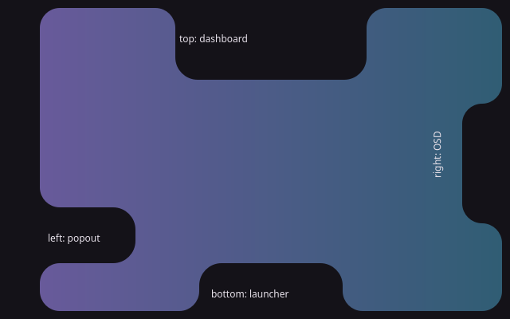

# Caelestia 3: The Frame and the Drawer System

This chapter builds the part that makes Caelestia *Caelestia*: one fullscreen window per monitor that draws the frame and holds every panel as a **drawer** that slides out of a frame edge. It's the most important chapter of the Caelestia rebuild. Once you understand it, every later module is just "a drawer with some content".



*Rendered from the files in this chapter (`Border.qml` + `PanelBg.qml`): a frame with a 50 px left side for the bar, and drawers on all four edges melting into it.*

## The idea in one picture

<div class="preview"><svg width="660" height="300" viewBox="0 0 660 300"><g font-size="11"><g transform="translate(10 20)"><rect width="280" height="200" fill="#3a5a8c" opacity=".5"/><path d="M0 0H280V200H0Z M40 8H262Q272 8 272 18V182Q272 192 262 192H50Q40 192 40 182Z" fill="#141218" fill-rule="evenodd"/><rect x="100" y="8" width="90" height="46" rx="12" fill="#141218"/><text x="140" y="225" fill="#a6adc8" text-anchor="middle">what you see</text></g><g transform="translate(360 20)"><rect width="280" height="200" fill="none" stroke="#585b70" stroke-dasharray="4 3"/><rect width="40" height="200" fill="#f9e2af" opacity=".55"/><rect width="280" height="8" fill="#f9e2af" opacity=".55"/><rect x="272" width="8" height="200" fill="#f9e2af" opacity=".55"/><rect y="192" width="280" height="8" fill="#f9e2af" opacity=".55"/><rect x="100" y="8" width="90" height="46" fill="#f9e2af" opacity=".55"/><text x="150" y="120" fill="#a6adc8" text-anchor="middle">clicks pass through here</text><text x="140" y="225" fill="#a6adc8" text-anchor="middle">what takes input (the mask)</text></g><g transform="translate(10 260)" fill="#cdd6f4"><text>One transparent window covers the whole screen. It draws the frame and the open drawers,</text><text y="16">and its input mask is exactly those shapes, so your apps get every click in the middle.</text></g></g></svg></div>

Files in this chapter:

```text
modules/drawers/  Drawers  Exclusions  ContentWindow  Border  PanelBg  Panels  Interactions
components/       DrawerWrapper
```

## Module 1: One frame per monitor

@include cae/modules/drawers/Drawers.qml

`Variants` creates one copy of its delegate per screen. Each copy is a `Scope` with two things: the **Exclusions** (which reserve space) and the **ContentWindow** (which draws everything).

## Module 2: Reserving space without blocking anything

The frame window covers the entire screen and ignores exclusive zones, otherwise it would push itself away. But tiled windows still need to stay *inside* the frame. Caelestia's trick: four extra, invisible, 1-pixel windows that do nothing but reserve space.

@include cae/modules/drawers/Exclusions.qml

::: walk
@ 14-17 | One per edge
Each `Zone` is anchored to one edge only. The left one reserves the bar's width (it changes when the bar hides), the others reserve the frame thickness.
@ 19-27 | An invisible window
1×1 pixel, transparent, with an empty input mask (`Region {}`), so it can never be seen or clicked. Its only job is `exclusiveZone`: Hyprland keeps tiled windows that many pixels away from that edge.
:::

> [!NOTE] In the original
> `modules/drawers/Exclusions.qml` does exactly this. It's a good example of a trick worth stealing: separating "what reserves space" from "what draws".

## Module 3: The frame shape

@include cae/modules/drawers/Border.qml

::: walk
@ 17-22 | A shape with a hole
A `ShapePath` with `OddEvenFill` fills areas covered an **odd** number of times. Two rectangles are drawn: the full window, and an inner rounded rectangle. The middle is covered twice (even), so it stays empty. The strip between them is covered once and gets filled: that's the frame.
@ 23-29 | The inner hole
The hole starts `leftThickness` from the left (the bar's width) and `thickness` from the other edges, with rounded corners. `PathRectangle` needs Qt 6.8 or newer.
:::

## Module 4: Drawer backgrounds that melt into the frame

A plain rounded rectangle next to the frame would look glued on. Caelestia's panels instead flow out of the frame with concave curves where they meet it. The rebuild draws that with one path per drawer:

<div class="preview"><svg width="560" height="170" viewBox="0 0 560 170"><g font-size="11"><rect x="0" y="0" width="560" height="14" fill="#141218"/><path d="M150 14 A30 30 0 0 1 180 44 V110 A28 28 0 0 0 208 138 H352 A28 28 0 0 0 380 110 V44 A30 30 0 0 1 410 14 Z" fill="#141218"/><g fill="none" stroke="#f9e2af" stroke-width="2"><path d="M150 14 A30 30 0 0 1 180 44"/><path d="M380 44 A30 30 0 0 1 410 14"/></g><g fill="none" stroke="#89b4fa" stroke-width="2"><path d="M180 110 A28 28 0 0 0 208 138"/><path d="M352 138 A28 28 0 0 0 380 110"/></g><text x="100" y="40" fill="#f9e2af">concave "ear"</text><text x="420" y="40" fill="#f9e2af">concave "ear"</text><text x="90" y="135" fill="#89b4fa">convex corner</text><text x="395" y="135" fill="#89b4fa">convex corner</text><text x="280" y="80" fill="#cdd6f4" text-anchor="middle">panel body</text><text x="280" y="160" fill="#a6adc8" text-anchor="middle">u runs along the edge → · v goes into the screen ↓</text></g></svg></div>

@include cae/modules/drawers/PanelBg.qml

::: walk
@ 10-16 | What it follows
`panel` is the drawer's wrapper item (Module 6). Its size is the *visible* part of the drawer, so the background grows as the drawer slides out. `offsetX`/`offsetY` say where the drawers' container sits inside the window (after the bar and the frame).
@ 18-22 | Sizes along and into the edge
`along` is the panel's size parallel to the edge, `depth` how far it reaches into the screen. `r` (ear radius) and `cr` (corner radius) shrink when the panel is small, so a drawer that is just starting to open doesn't produce broken curves.
@ 23-26 | Arc directions
A path drawn for the top edge can be reused for the other edges by mapping its coordinates. Mapping to the bottom or left edge is a **reflection**, and a reflection reverses which way an arc turns, so the clockwise/counter-clockwise directions swap for those edges.
@ 28-34 | One path, four edges
The path is written once in "edge coordinates": `u` along the edge and `v` into the screen. `px()`/`py()` turn `(u, v)` into real `x`/`y` for the chosen edge. For the right edge, `v` is measured from the right side (`width - v`); for the bottom, from the bottom.
@ 39-42 | Position and size
The shape is wider than the panel by one ear radius on each side, because the ears stick out past the panel's sides.
@ 50-60 | The path itself
Start on the frame edge, curve concavely into the panel's side (the ear), go down the side, round the far corner, cross the far side, round the other corner, come back up, and curve out into the frame again.
:::

> [!NOTE] In the original
> Caelestia draws the frame and all panels with its **Blobs** plugin (`plugin/src/Caelestia/Blobs/`): each shape is a signed distance field, and the GPU smoothly *blends* nearby shapes. That gives the same melted joints, plus a slight stretch ("deform") while panels move. The rebuild gets the look with QML `Shape`s and no C++.

## Module 5: The frame window

@include cae/modules/drawers/ContentWindow.qml

::: walk
@ 16-18 | Per-screen state
Each window owns a `ScreenState` (which drawers are open on this monitor) and exposes the bar so `Drawers.qml` can read its width for the exclusions.
@ 20-25 | A fullscreen, transparent layer
Anchored to all four edges = fullscreen. `ExclusionMode.Ignore` because the Exclusions windows reserve the space. The namespace lets Hyprland blur it (with transparency on). Keyboard focus is only requested while the launcher or session menu is open, so normally your apps keep the keyboard.
@ 27 | Register
Keybinds find this screen's state through `Visibilities`.
@ 29-43 | The input mask
This is what makes a fullscreen window harmless. The mask is the union of the four frame strips and every drawer's wrapper. Anything outside it (the middle of your screen) lets clicks and scrolls fall through to the windows below. A closed drawer's wrapper has zero depth, so it adds nothing.
@ 45-54 | Click outside to close
[[HyprlandFocusGrab]] watches for clicks outside this window. While the launcher, session menu or sidebar is open, clicking anywhere else clears the grab, and `onCleared` closes them.
@ 56-65 | The scrim
A dark overlay fades in behind the session menu so it feels modal. It isn't in the mask, so it can't block anything.
@ 67-77 | One layer for all surfaces
The frame and all drawer backgrounds are drawn **inside one layer**. They're drawn fully opaque, and the layer as a whole gets the surface opacity. If each shape were transparent on its own, the places where they overlap (the ears over the frame) would look darker. The layer also gets one shared shadow, so the frame and its drawers cast a single soft shadow onto your wallpaper and windows.
@ 79-93 | Frame and drawer backgrounds
The frame's left side is always exactly the bar's width (it animates when the bar hides). Each `Bg` follows one drawer and attaches to its edge.
@ 96-123 | Content
`Interactions` (hover zones) fills the window and contains the drawers (`Panels`, inset by the frame) and the bar (`BarWrapper`, on the left). Being children of `Interactions` means hover over any of them is reported to it.
@ 125-131 | A preset background
An inline component with the shared settings, so each `Bg` line above only says which drawer and which edge.
:::

## Module 6: The drawer pattern

Every Caelestia drawer uses the same trick. The drawer's wrapper grows from 0 to the content's size **along the slide direction** and clips its content, which stays glued to the far side. As the wrapper grows, the content appears to slide out from behind the frame.

<div class="preview"><svg width="560" height="150" viewBox="0 0 560 150"><g font-size="11"><rect x="0" y="0" width="560" height="10" fill="#141218"/><g transform="translate(30 10)"><rect width="140" height="0" fill="#141218"/><rect y="-80" width="140" height="80" rx="10" fill="none" stroke="#585b70" stroke-dasharray="3 3"/><text x="70" y="40" fill="#a6adc8" text-anchor="middle">offsetScale = 1</text><text x="70" y="56" fill="#a6adc8" text-anchor="middle">height 0 (hidden)</text></g><g transform="translate(210 10)"><rect width="140" height="40" fill="#141218"/><rect y="-40" width="140" height="80" rx="10" fill="none" stroke="#585b70" stroke-dasharray="3 3"/><rect y="0" width="140" height="40" fill="#cba6f7" opacity=".25"/><text x="70" y="60" fill="#a6adc8" text-anchor="middle">offsetScale = 0.5</text><text x="70" y="76" fill="#a6adc8" text-anchor="middle">half visible, clipped</text></g><g transform="translate(390 10)"><rect width="140" height="80" rx="0" fill="#141218"/><rect width="140" height="80" fill="#cba6f7" opacity=".25"/><text x="70" y="45" fill="#cdd6f4" text-anchor="middle">content</text><text x="70" y="100" fill="#a6adc8" text-anchor="middle">offsetScale = 0</text><text x="70" y="116" fill="#a6adc8" text-anchor="middle">fully open</text></g></g></svg></div>

@include cae/components/DrawerWrapper.qml

::: walk
@ 9-12 | Open state and progress
`offsetScale` is the drawer's "closedness": 0 = open, 1 = closed. It follows `open` through a `Behavior`, so setting `open` is all a module ever does. The content goes in as a child (`default property alias`).
@ 14-17 | Reading the content's size
The wrapper reads the first child's implicit size. Content therefore only has to say how big it wants to be.
@ 19-22 | Growing and clipping
Only the dimension that crosses the edge grows: height for top/bottom drawers, width for left/right ones. `clip: true` hides the part of the content that hasn't come out yet. When fully closed the wrapper is invisible, so it costs nothing to draw.
@ 24-26 | Open and close feel different
Opening uses the springy `Spatial` curve; closing uses `Emphasized`, which accelerates away. Different motion for entering and leaving is a Material 3 rule that Caelestia follows.
@ 28-37 | Glued to the far side
For a top drawer the content's bottom is aligned to the wrapper's bottom (`y = height - contentHeight`, negative while opening), so the bottom of the panel appears first, as if it were pushed down out of the frame. Left drawers align to the right side; right and bottom drawers need no offset. The content also fades in slightly.
:::

> [!NOTE] In the original
> Each module has a `Wrapper.qml` (for example `modules/dashboard/Wrapper.qml`) with an `offsetScale` property, `Behavior on offsetScale { Anim {} }`, and a negative anchor margin of `-implicitHeight * offsetScale`. The OSD and session wrappers use the "grow and clip" form shown here. The rebuild uses one shared component for all of them.

## Module 7: Where each drawer lives

@include cae/modules/drawers/Panels.qml

The container is inset by the frame (and by the bar on the left), so `anchors.top: parent.top` means "touching the top frame edge". Each drawer is a `DrawerWrapper` whose `open` comes from the screen state, except two:

- **notifications** open by themselves whenever there are popups (and hide while the notification centre is open);
- **popouts** use their own wrapper (it also slides toward the hovered bar item, [[ch:cae4-bar]]).

The OSD's right margin equals the session drawer's width, so when the session menu slides out, the OSD moves aside instead of overlapping.

## Module 8: Opening drawers by touching the frame

@include cae/modules/drawers/Interactions.qml

::: walk
@ 10-20 | A hover-only mouse area
`acceptedButtons: Qt.NoButton` means it never takes clicks (the bar and drawers inside it still do), but with `hoverEnabled` it receives every pointer move over the window. The four flags remember whether the pointer is currently inside each zone.
@ 25-33 | Generous zones
A drawer's hover zone is its size **plus the frame rounding on each side**, so you don't have to hit it perfectly. Panel coordinates are relative to the drawers' container, so the bar width and frame thickness are added to get window coordinates.
@ 35-40 | Bar popouts
Over the bar, ask the bar what's under the pointer (it opens the matching popout). Away from both the bar and the open popout, close it.
@ 42-43 | Auto-hiding bar
In non-persistent mode the bar is only as wide as the frame; touching the left edge marks it hovered and it slides out.
@ 45-46 | Edge-triggered changes
The dashboard zone is the top edge (plus the dashboard's own area once it's open). The state is only changed when you **enter or leave** the zone. A drawer opened with a keybind therefore stays open while you move around elsewhere, instead of being closed by the next mouse move.
@ 48-56 | The other zones
OSD: the right edge in the middle (and not while the session menu is open). Sidebar: the top-right corner. Utilities: the bottom-right corner.
@ 59-62 | Leaving the window
Moving into the middle of the screen leaves the window (the mask ends there), so `onExited` runs the checks with a point outside every zone, and all hover-opened drawers close.
:::

> [!NOTE] In the original
> `modules/drawers/Interactions.qml` is about 330 lines because it also handles **drag gestures** (drag the bar out, swipe the session menu in, pull the launcher up on touchscreens), shortcut-vs-hover hand-over, and fullscreen windows. `Regions.qml` builds the input mask with `Intersection.Xor` and `Subtract` instead of a simple union.

## Checkpoint

With the files so far plus a temporary `shell.qml` that only contains `Drawers {}`, you get the frame on every monitor and empty drawers. Comment out the module imports in `Panels.qml` you haven't written yet, or download the full rebuild and read ahead.

## Practice

::: exercise warm | Thicker frame
Set `"border": { "thickness": 20, "rounding": 40 }` in `~/.config/cae/shell.json` and save. What changes, and why don't you need to restart?
--- solution
The frame, the reserved space, the drawers' inset and the ears all follow, because every one of them reads `Config.border.*`, and `Config` reloads the file on change.
:::

::: exercise practice | A drawer on the left edge
Add a "notes" drawer on the left edge, below the middle, that opens with a keybind. Use `DrawerWrapper { edge: "left" }`, add a `notes` flag to `ScreenState`, a `Bg` line in `ContentWindow`, a mask `Region` and a shortcut.
--- hint
Five small edits: ScreenState, Panels (the wrapper + content), ContentWindow (Bg and mask), Shortcuts (a new `GShortcut`).
:::

::: exercise practice | Hover delay
Opening the dashboard as soon as you touch the top edge can be annoying. Make it open only after the pointer stays in the zone for 200 ms.
--- solution
Instead of setting `screenState.dashboard = dash` immediately, start a `Timer { id: dashDelay; interval: 200; onTriggered: root.screenState.dashboard = root.inDashboard }` when entering, and close immediately when leaving:
```qml
if (dash !== inDashboard) {
    inDashboard = dash;
    if (dash) dashDelay.restart(); else { dashDelay.stop(); screenState.dashboard = false; }
}
```
:::

::: exercise challenge | Drag the launcher up
Caelestia lets you open the launcher by dragging up from the bottom edge. Implement it: accept the left button in Interactions, remember the press position, and open the launcher when the pointer moves 30 px up from a press on the bottom frame strip.
--- hint
`acceptedButtons: Qt.LeftButton`, `onPressed: e => dragStart = Qt.point(e.x, e.y)`, then in `onPositionChanged` check `pressed && dragStart.y > height - t - 5 && dragStart.y - e.y > 30`. Make sure clicks still reach the bar (call `mouse.accepted = false` when the press isn't on the bottom strip).
:::
