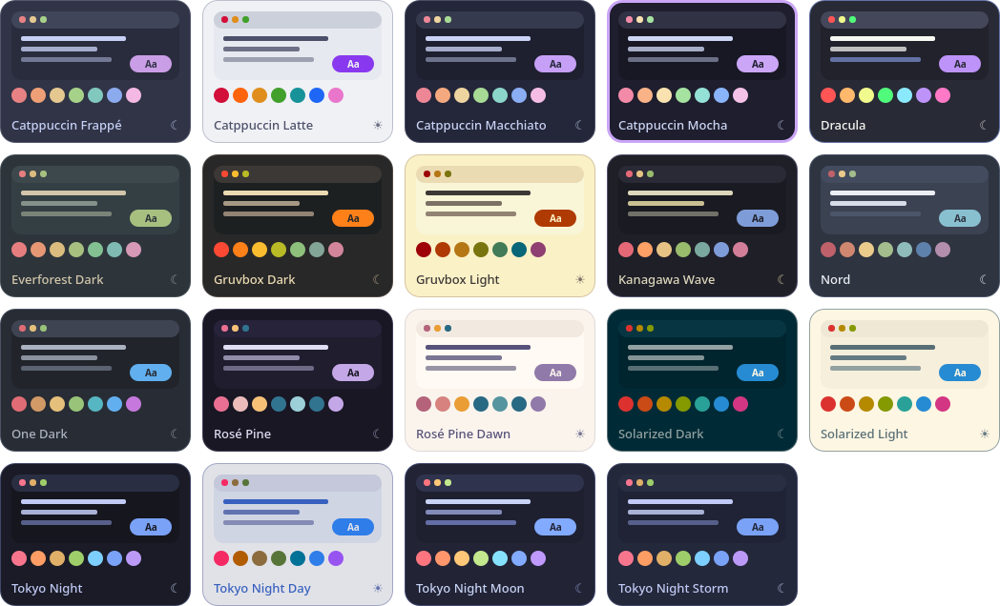

# Theming 1: Colours, Palettes and Roles

A **theme** is a set of colours your whole desktop agrees on. Catppuccin, Tokyo Night, Gruvbox and Nord are themes. A **theme switcher** lets you change all of them at once, with one click or one key. This part builds a complete one for Quickshell: 19 ready-made themes, a picker with live previews, light/dark twins, automatic day/night switching, and export to your terminal, Hyprland and GTK apps.



*Every card above is the real `ThemeCard.qml` from this part, drawn in its own theme's colours.*

This first chapter is the theory you need, in plain words. No code to write yet, just ideas you'll use in every later chapter.

## Colours in QML

QML understands colours in several notations. They all mean the same kind of value, a `color`:

```qml
Rectangle { color: "#cba6f7" }                  // hex: red cb, green a6, blue f7
Rectangle { color: "#80cba6f7" }                // 8 digits: the first two are opacity (80 = 50%)
Rectangle { color: Qt.rgba(0.8, 0.65, 0.97, 1) } // channels from 0 to 1
Rectangle { color: Qt.hsla(0.75, 0.85, 0.81, 1) } // hue, saturation, lightness
Rectangle { color: "transparent" }
```

> [!WARNING] Opacity comes first in QML
> In CSS, `#cba6f780` puts the opacity at the end. QML's 8-digit form is `#AARRGGBB`, with opacity **first**: `#80cba6f7`. A common source of "why is my colour wrong?".

Every `color` value also has parts you can read: `c.r`, `c.g`, `c.b`, `c.a` (0 to 1), and `c.hslHue`, `c.hslSaturation`, `c.hslLightness`. The theme service uses them to mix colours and measure contrast.

## Palette vs roles: the one idea that matters

Look at Catppuccin's official colours: **rosewater, flamingo, pink, mauve, red, maroon, peach, yellow, green, teal, sky, sapphire, blue, lavender, text, subtext1, subtext0, overlay2…0, surface2…0, base, mantle, crust**. That's a **palette**: named colours with no instructions on where to use them.

Your widgets shouldn't know those names. A bar shouldn't say "make me `mantle`", because Tokyo Night has no `mantle` and Nord calls its colours `nord0` to `nord15`. Instead, widgets ask for a **role**: what the colour is *for*.

<div class="preview"><svg width="640" height="250" viewBox="0 0 640 250"><g font-size="11"><text x="20" y="22" fill="#cdd6f4" font-size="13">palette (theme-specific names)</text><g transform="translate(20 34)"><rect width="140" height="26" rx="6" fill="#1e1e2e" stroke="#585b70"/><text x="10" y="17" fill="#cdd6f4">base #1e1e2e</text><rect y="34" width="140" height="26" rx="6" fill="#181825" stroke="#585b70"/><text x="10" y="51" fill="#cdd6f4">mantle #181825</text><rect y="68" width="140" height="26" rx="6" fill="#cdd6f4"/><text x="10" y="85" fill="#1e1e2e">text #cdd6f4</text><rect y="102" width="140" height="26" rx="6" fill="#cba6f7"/><text x="10" y="119" fill="#1e1e2e">mauve #cba6f7</text><rect y="136" width="140" height="26" rx="6" fill="#f38ba8"/><text x="10" y="153" fill="#1e1e2e">red #f38ba8</text></g><g stroke="#89b4fa" stroke-width="1.5" fill="none"><path d="M162 47 C230 47 230 47 300 47"/><path d="M162 81 C230 81 230 81 300 81"/><path d="M162 115 C230 115 230 115 300 115"/><path d="M162 149 C230 149 230 149 300 149"/><path d="M162 183 C230 183 230 183 300 183"/></g><text x="300" y="22" fill="#cdd6f4" font-size="13">roles (the same for every theme)</text><g transform="translate(300 34)" fill="#cdd6f4"><rect width="120" height="26" rx="6" fill="#313244"/><text x="10" y="17">background</text><rect y="34" width="120" height="26" rx="6" fill="#313244"/><text x="10" y="51">surface</text><rect y="68" width="120" height="26" rx="6" fill="#313244"/><text x="10" y="85">text</text><rect y="102" width="120" height="26" rx="6" fill="#313244"/><text x="10" y="119">primary</text><rect y="136" width="120" height="26" rx="6" fill="#313244"/><text x="10" y="153">red / error</text></g><g stroke="#a6e3a1" stroke-width="1.5" fill="none"><path d="M422 47 H480"/><path d="M422 81 H480"/><path d="M422 115 H480"/><path d="M422 149 H480"/><path d="M422 183 H480"/></g><g transform="translate(480 34)" fill="#a6adc8"><text y="17">bar background</text><text y="51">cards, popups</text><text y="85">labels</text><text y="119">active workspace</text><text y="153">low battery</text></g><text x="320" y="238" fill="#a6adc8" text-anchor="middle">each theme file says which palette colour plays which role; widgets only use roles</text></g></svg></div>

Switching themes then only changes the middle column's arrows. The widgets never change.

## The 17 roles used in this part

| Role | Used for | Example (Catppuccin Mocha) |
|---|---|---|
| `background` | the base of the bar and panels | base |
| `surface` | slightly different areas: cards, inputs | mantle |
| `surfaceHigh` | raised things: hovered items, chips, title bars | surface0 |
| `border` | outlines and dividers | surface1 |
| `text` | normal text and icons | text |
| `textMuted` | secondary text | subtext0 |
| `textFaint` | hints, placeholders, disabled | overlay0 |
| `primary` | the accent: active, selected, focused | mauve |
| `onPrimary` | text on top of `primary` | base |
| `secondary` | a second accent | blue |
| `red` `orange` `yellow` `green` `cyan` `blue` `magenta` | the seven accent hues (graphs, tags, terminals) | red, peach, yellow, green, teal, blue, pink |

Three **meanings** come from the accents: `success` = green, `warning` = yellow, `error` = red. Use the meaning in your widgets (`Theme.colors.error` for a low battery), not the hue, so a theme could one day change what "error" looks like.

> [!TIP] Why `onPrimary`?
> Text on an accent needs its own colour. On a dark theme the accent is light (mauve), so its text must be dark; on a light theme it's the opposite. The theme file decides, so your button is readable everywhere.

## Contrast: making text readable

Not every pair of colours can be read. The web's accessibility rules (WCAG) measure **contrast** as a ratio from 1:1 (identical) to 21:1 (black on white):

| Ratio | Good for |
|---|---|
| 7:1 and above | everything, including small text |
| 4.5:1 | normal text |
| 3:1 | large text and icons |
| below 3:1 | decoration only |

The theme service has a `contrast()` function implementing exactly this formula ([[ch:th3-theme-service]]), and the picker shows the current theme's text contrast in its footer. All 19 built-in themes give their `text` at least 7:1 on `background`.

## Light and dark

Every theme in this part is marked `"variant": "dark"` or `"light"`. Many families come in both: Catppuccin Mocha / Latte, Tokyo Night / Tokyo Night Day, Gruvbox Dark / Light, Rosé Pine / Dawn, Solarized Dark / Light. The switcher can jump between these **twins** with one key, and can switch automatically at sunrise and sunset ([[ch:th5-theme-switcher]]).

Two things change between light and dark that beginners often miss:

1. **Depth flips.** On dark themes, raised surfaces are *lighter* than the background; on light themes they're often *darker*. Roles hide this: `surfaceHigh` is always "the raised one".
2. **Accents get darker on light themes.** Catppuccin's mauve is `#cba6f7` in Mocha but `#8839ef` in Latte, because a pale mauve on white can't be read.

## A simple rule for using colour: 60-30-10

Designers balance a screen roughly as **60%** background, **30%** surfaces and text, and **10%** accent. If everything is mauve, nothing stands out. Use `primary` for the *one* thing that matters right now: the active workspace, the focused input, the selected item.

## What you'll build

| Chapter | You build |
|---|---|
| [[ch:th2-theme-files]] | the theme file format and all 19 theme files |
| [[ch:th3-theme-service]] | the `Theme` service: loading, roles, contrast, switching, saving, day/night |
| [[ch:th4-themed-widgets]] | widgets that follow the theme and fade between themes |
| [[ch:th5-theme-switcher]] | the picker window with live preview, keybinds and a demo bar |
| [[ch:th6-adding-themes]] | adding your own themes, converting base16 schemes, checking contrast |
| [[ch:th7-beyond-the-shell]] | theming kitty, Hyprland and GTK from the same theme, and wallpaper themes |

Everything is in the downloadable kit [theming.zip](../examples/theming.zip) ([browse](../examples/theming/)). Unzip it into `~/.config/quickshell/` and run `qs -c theming`.

> [!NOTE] How this relates to the rest of the book
> [[ch:44-theming]] generates colours from your wallpaper with matugen; [[ch:r0-theme-system]] built a quick preset switcher with colours written inside QML. This part is the full version: themes as files you can add without touching code, real Catppuccin/Tokyo Night palettes, previews, export and scheduling. Chapter 7 shows how to add a wallpaper theme next to the fixed ones.

## Practice

::: exercise warm | Read a colour
In a scratch shell, show `Text { text: c.hslLightness.toFixed(2); property color c: "#cba6f7" }`. Try `#1e1e2e` and `#eff1f5`. What number separates "dark" from "light"?
--- solution
Around 0.5. `#1e1e2e` gives about 0.15 and `#eff1f5` about 0.95. That's why code often checks `c.hslLightness < 0.5` to decide whether a colour is dark.
:::

::: exercise practice | Palette or role?
Which of these are palette names and which are roles: `mauve`, `primary`, `nord8`, `surface`, `bg_highlight`, `textMuted`, `love`?
--- solution
Palette names: `mauve` (Catppuccin), `nord8` (Nord), `bg_highlight` (Tokyo Night), `love` (Rosé Pine). Roles: `primary`, `surface`, `textMuted`. (Catppuccin also has a palette colour called `surface0`, a good example of why roles need their own names.)
:::

::: exercise practice | 60-30-10
Take a screenshot of your current bar. Roughly what share of it is accent colour? If it's more than 10–15%, which elements could use `surface` or `text` instead?
:::
